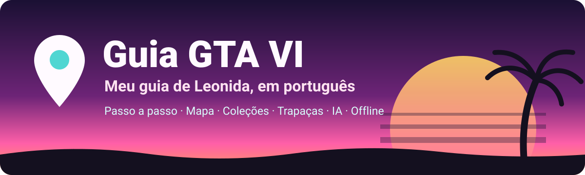
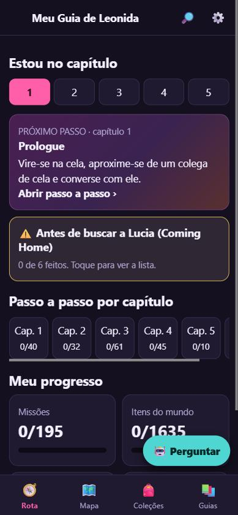
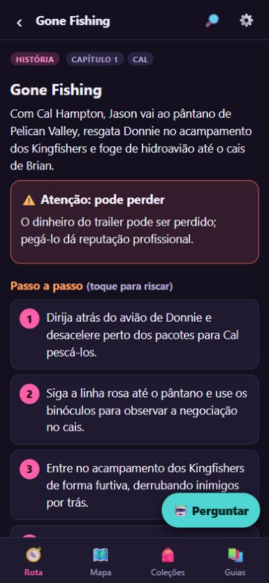
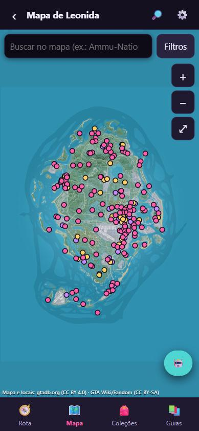
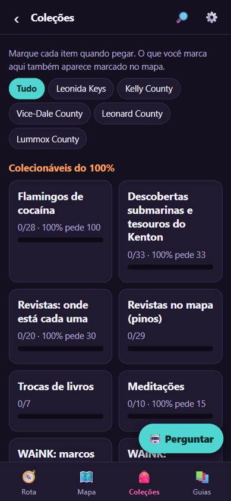
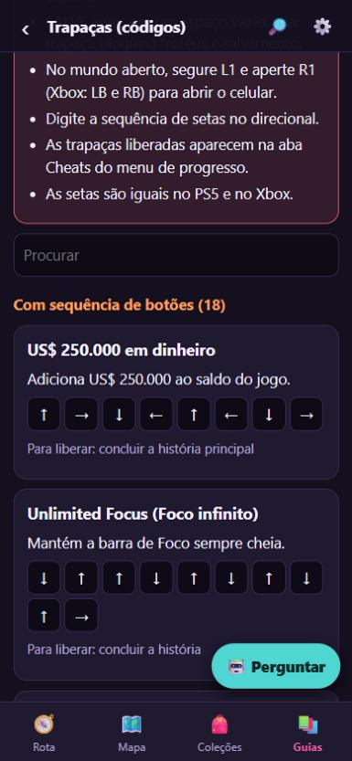

<p align="center">
  
</p>

<p align="center">
  <a href="https://xandygomes.github.io/Guia.GTA.VI/"></a>
</p>

<p align="center">
  
  
  
  
  
  
</p>

<p align="center">
  <b>Um guia de fã para jogar GTA VI sem deixar nada para trás.</b><br>
  Abra no celular ao lado do videogame, siga o próximo passo e marque o que já pegou.
</p>

---

## 📱 Telas

<table>
  <tr>
    <td align="center"><br><sub><b>Próximo passo</b></sub></td>
    <td align="center"><br><sub><b>Passo a passo</b></sub></td>
    <td align="center"><br><sub><b>Mapa interativo</b></sub></td>
  </tr>
  <tr>
    <td align="center"><br><sub><b>Coleções</b></sub></td>
    <td align="center"><br><sub><b>Trapaças</b></sub></td>
    <td></td>
  </tr>
</table>

## ✨ O que tem

| | Recurso | Detalhes |
|---|---|---|
| 🧭 | **Rota por capítulo** | 195 tarefas, principais e opcionais, na ordem em que liberam |
| ⚠️ | **Pontos sem volta** | Listas do que fazer antes de avançar, para nada se perder |
| 🗺️ | **Mapa de Leonida** | 7 níveis de zoom, busca, filtros e marcação do que já foi pego |
| 🎒 | **Coleções** | Mais de 1.600 itens para marcar, incluindo as 480 cartas |
| 🎮 | **Guias** | Trapaças, easter eggs, armas, veículos, dinheiro, troféus, 100% e finais |
| 🤖 | **Perguntar à IA** | Responde usando os dados do guia e a tela que você está vendo |
| 🙈 | **Sem spoiler** | Capítulos que você não alcançou ficam escondidos |
| 💾 | **Seu progresso** | Salvo no aparelho, com exportação e importação em arquivo |

## 📲 Instalar no celular

1. Abra **https://xandygomes.github.io/Guia.GTA.VI/**
2. **Android (Chrome):** menu ⋮ → *Instalar app* ou *Adicionar à tela inicial*.<br>
   **iPhone (Safari):** botão *Compartilhar* → *Adicionar à Tela de Início*.
3. Para usar sem internet: ⚙️ *Ajustes* → *Mapa sem internet*.

## 🤖 Ligar a IA (plano gratuito)

1. Crie uma chave em [aistudio.google.com/apikey](https://aistudio.google.com/apikey).
2. No app, toque em **Perguntar**, cole a chave e salve.

A chave fica **somente no seu aparelho**; este repositório não contém nenhuma. No plano gratuito há limite de uso, e o Google pode usar as conversas para melhorar os produtos dele.

## 🛠️ Como foi feito

- **HTML, CSS e JavaScript puros**, sem framework, sem dependências e sem etapa de build para o app.
- **Mapa próprio em `<canvas>`**, com arrastar, pinça para zoom e blocos carregados sob demanda.
- **Service Worker** guarda o app e o mapa para uso offline.
- **Busca de contexto no próprio aparelho:** só os trechos ligados à pergunta vão para a IA.
- **Segurança:** Content Security Policy restritiva e todo texto escapado antes de ir para a tela.

```text
├── index.html            tela única do app
├── css/  js/             aparência, telas, mapa e assistente
├── dados/                missões, coleções, guias e marcadores
├── mapa/tiles/           blocos do mapa
├── sw.js                 funcionamento offline
└── servidor.py           servidor local opcional
```

## 💻 Rodar no computador

Com Python instalado:

```bash
python servidor.py
```

O guia abre em `http://localhost:8060`. No Windows, também dá para usar `iniciar.bat` ou `iniciar-no-celular.bat` (mesmo Wi-Fi).

## 📊 Estado do conteúdo

Pesquisa de **27/11/2026**. O jogo é recente e os guias da internet ainda estão sendo escritos.

| Conteúdo | Situação |
|---|---|
| Missões dos 5 capítulos | ✅ com passo a passo (tarefas de espera têm só uma orientação curta) |
| Cartas colecionáveis | ✅ 18 conjuntos com todas as posições |
| Flamingos de cocaína | 🟡 28 de 125 locais (o 100% pede 100) |
| Trapaças | 🟡 61 listadas, 18 com a sequência de botões |
| Revistas, animais e tags No Flusher | 🟡 incompletos |

Os sites divergem em alguns preços e locais. Se o jogo mostrar diferente, vale o jogo.

## 🙏 Fontes e licenças

| Conteúdo | Origem | Licença |
|---|---|---|
| Mapa e locais | [gtadb.org](https://map.gtadb.org) e colaboradores | [CC BY 4.0](https://creativecommons.org/licenses/by/4.0/) |
| Marcadores do mapa | [GTA Wiki (Fandom)](https://gta.fandom.com/wiki/Map:GTA_VI_Places_of_Interest) | CC BY-SA |
| Locais das cartas | [The Games Wiki](https://thegameswiki.com/gta6/wiki/collectible-card-sets), traduzidos e resumidos | [CC BY-NC-SA 4.0](https://creativecommons.org/licenses/by-nc-sa/4.0/) |
| Guias de missões e atividades | Resumos em palavras próprias de [Promptowy](https://promptowy.com/pt-br/gta-6/detonado/), [PowerPyx](https://www.powerpyx.com/gta-6-full-walkthrough-all-missions/), [GTA6 Route](https://gta6route.com/), [Tech4Gamers](https://gta.tech4gamers.com/), [GTA6BUGS](https://gta6bugs.com/) e outros | direitos dos respectivos autores |

As páginas originais aparecem em cada tela do app e em *Guias → Fontes*. Se você é autor de algum conteúdo e quer que ele saia, [abra uma issue](https://github.com/XandyGomes/Guia.GTA.VI/issues).

## ⚖️ Aviso

Projeto de fã, **não oficial** e sem fins comerciais. Sem vínculo com a Rockstar Games ou a Take-Two Interactive. *Grand Theft Auto* e marcas relacionadas pertencem aos seus donos.

---

<p align="center">
  Feito por <a href="https://github.com/XandyGomes"><b>Alexandre Gomes</b></a> · bom jogo! 🌴
</p>
